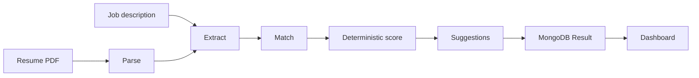

# Matchify AI

[](https://github.com/REPLACE_OWNER/Matchify-AI/actions/workflows/ci.yml)

AI resume analysis that compares a PDF resume to a job description, lists matched and missing skills, and stores the report for the signed-in user.

Replace `REPLACE_OWNER` in the badge URL with the GitHub owner after the repository is public. Put a screenshot or GIF at `docs/images/demo.gif` and it will show below.


## The Problem

Matchify.AI addresses the real-world problem of the growing gap between job seekers' qualifications and employers' recruitment requirements. Many candidates struggle to understand whether their resumes align with a particular job vacancy, which essential skills or keywords they are missing, and why their applications may be rejected by Applicant Tracking Systems (ATS) before reaching a human recruiter. At the same time, manually reviewing and comparing resumes against job descriptions is time-consuming for recruiters. Matchify.AI solves these challenges through AI-powered resume analysis and job-description matching. It evaluates a candidate's resume against specific job requirements, identifies matching and missing skills, highlights important keywords, assesses technical and soft skills, and provides actionable feedback to improve the resume. By making resume evaluation more accessible, understandable and data-driven, Matchify.AI helps job seekers make informed career decisions, improve their applications, and prepare for real-world employment opportunities.

## The solution and features

- PDF resume plus pasted job description, with a streamed progress sequence: Parsing, Extracting, Matching, Scoring, Suggesting.
- Match score computed in code from structured skills (50% must-have, 20% nice-to-have, 20% keywords, 10% experience alignment).
- Matched skills, missing skills, keyword counts, and before/after rewrite suggestions.
- A second score after missing keywords that show up in a rewritten summary.
- Saved history for the signed-in user, with 10 reports per page on `/dashboard/analyses`.
- Google and GitHub sign-in, plus email and password.
- Admin pages for users with role `admin` (or `ADMIN_EMAIL`).
- Optional job-description expansion and cover-letter draft from the landing page.
- Delete saved analyses without deleting the account, or delete the account.

## Architecture



See [docs/ARCHITECTURE.md](docs/ARCHITECTURE.md).

## Design decisions

- **Several model calls instead of one.** Each step has its own prompt file under `lib/ai/prompts/` (`v1`) and its own Zod schema. A bad JSON response is sent back to the model up to two times, then the request fails with a generic error.
- **The model does not pick the score.** `lib/scoring.ts` is a pure function. Tests cover an empty resume, a full match, a miss, duplicate skills, and synonyms such as `JS` and `JavaScript`.
- **Zod on the way in and the way out.** Environment variables are checked when the Node server starts. API bodies and model JSON are parsed before they are stored.
- **Prompt injection.** Resume and job text are placed between `BEGIN UNTRUSTED` and `END UNTRUSTED` markers. The system instruction says to ignore instructions inside that text. Marker text inside the document is rewritten so it cannot close the block early.
- **Failures.** Primary model, then `GEMINI_MODEL_FALLBACK`. HTTP 429 and 5xx wait with exponential backoff. Timeouts abort the request. Clients receive `{ error: { code, message } }`.

## Tech stack

- Next.js 16.2.4 (App Router), React 19, TypeScript, Tailwind CSS 4
- MongoDB and Mongoose
- NextAuth 4 (Google, GitHub) and `jose` for the credentials cookie
- Google Gemini via the Generative Language REST API (`gemini-2.0-flash` by default, `gemini-2.5-flash` fallback)
- Zod, Vitest, Playwright

## Getting started

### Local

1. `npm install`
2. Copy `.env.example` to `.env.local` and fill in the values. `GEMINI_API_KEY`, `MONGODB_URI`, `NEXTAUTH_SECRET`, and `JWT_SECRET` are required.
3. `npm run dev` and open http://localhost:3000

To make an admin, set `ADMIN_EMAIL` to that user's email or set `role` to `admin` on their user document.

### Docker

```bash
export GEMINI_API_KEY=... NEXTAUTH_SECRET=... JWT_SECRET=...
docker compose up --build
```

This starts the app and MongoDB 7. The app listens on port 3000.

### Environment variables

| Name | Purpose |
| --- | --- |
| `GEMINI_API_KEY` | Gemini API key |
| `GEMINI_MODEL_PRIMARY` | First model (default `gemini-2.0-flash`) |
| `GEMINI_MODEL_FALLBACK` | Used after 429, 5xx, or timeout |
| `MONGODB_URI` | MongoDB connection string |
| `NEXTAUTH_URL` | Public site origin |
| `NEXTAUTH_SECRET` | NextAuth encryption secret |
| `JWT_SECRET` | Credentials-login JWT secret |
| `GOOGLE_CLIENT_ID` / `GOOGLE_CLIENT_SECRET` | Google OAuth |
| `GITHUB_ID` / `GITHUB_SECRET` | GitHub OAuth |
| `ADMIN_EMAIL` | Optional extra admin email |
| `UPSTASH_REDIS_REST_URL` / `UPSTASH_REDIS_REST_TOKEN` | Shared rate limit. Empty means in-memory |
| `RATE_LIMIT_MAX` / `RATE_LIMIT_WINDOW_MS` | Default 10 analyses per 60 seconds |
| `E2E_AUTH_BYPASS` | Set to `1` only for Playwright. Ignored in production |

## Testing

```bash
npm test                 # Vitest unit tests
npm run test:coverage    # same, with an 80% line threshold on lib/
npm run test:e2e         # Playwright. Needs MongoDB and Playwright browsers
npm run lint
npm run typecheck
npm run eval             # real Gemini API, not run in CI
```

`npm test` does not call Gemini or MongoDB. The pipeline tests use a fake `fetch`. Coverage is enforced at 80% lines and statements on `lib/` (auth options excluded).

Playwright signs in with the `e2e_user` cookie when `E2E_AUTH_BYPASS=1` and stubs `/api/analyze`, so the browser test does not call Gemini. The dev server still needs `MONGODB_URI` because other pages connect on demand.

## Evaluation results

`evals/cases/` has 10 synthetic resume and job pairs (no personal data). `npm run eval` runs the live pipeline three times and prints score variance and how often the score landed in the expected range.

This repository does not include a recorded eval run. Run `npm run eval` with a real `GEMINI_API_KEY` and paste the printed table here.

## Limitations and future work

- Scanned PDFs fail with a clear error. There is no OCR.
- Only PDF is accepted. The landing page does not accept DOCX.
- Experience alignment is a coarse rule (senior means at least 5 years extracted by the model).
- The synonym list is small (`javascript`, `react`, `nodejs`, `postgresql`, `kubernetes`, and a few others).
- Cover letters and generated job descriptions are still one model call, not the scored pipeline.
- Rate limiting is per process unless Upstash is configured.
- Legacy UI files still use `// @ts-nocheck`. `noImplicitAny` is off so the existing pages typecheck; new `lib/` code is checked with strict null checks.
- There is no background queue. A long analysis holds the HTTP stream open (route `maxDuration` is 60 seconds).

## Project structure

- `app/` — pages and route handlers
- `components/` — UI
- `lib/ai/` — Gemini client, prompts, pipeline
- `lib/services/` — persistence and session helpers
- `lib/scoring.ts` — deterministic score
- `evals/` — manual evaluation cases
- `e2e/` — Playwright
- `tests/` — Vitest

## License

No `LICENSE` file is included yet. Add one before you publish the repository.
