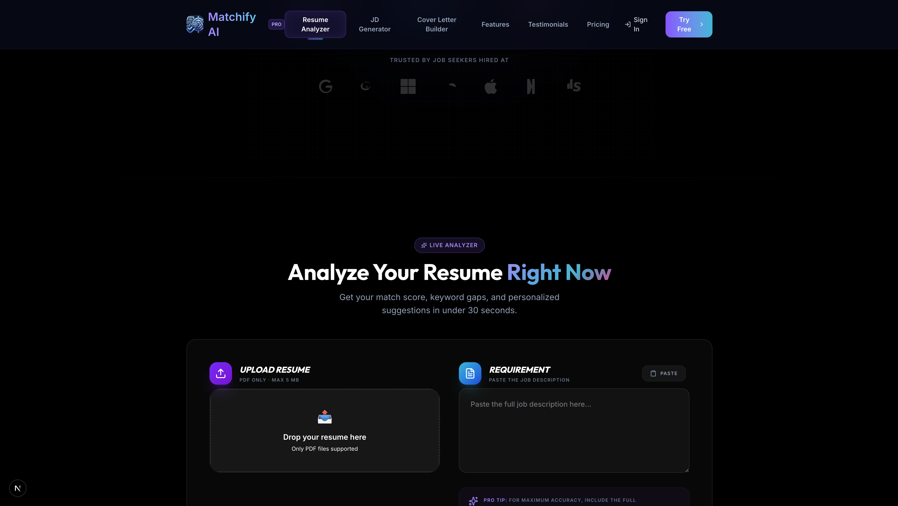
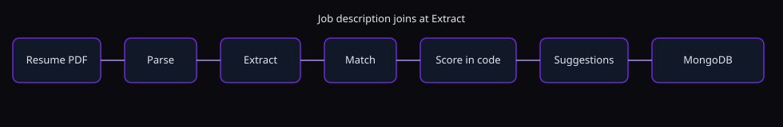
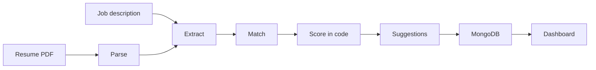

# Matchify AI

[](https://github.com/manojneupaneweb/Matchify-AI/actions/workflows/ci.yml)

I built this to see how well a resume lines up with one job description. You upload a PDF, paste the JD, and get a score, the skills that matched, the ones that did not, and a few rewrite ideas. Reports are saved to your account.





## The problem

Job seekers often cannot tell if a resume fits a posting, which keywords an ATS might want, or why an application dies before a person reads it. Comparing resumes to job descriptions by hand also takes time. Matchify checks a resume against one job description, lists matching and missing skills, and suggests edits.

## What it does

- PDF plus a pasted job description. The UI shows Parsing, Extracting, Matching, Scoring, Suggesting while the request runs.
- The score is calculated in `lib/scoring.ts`, not by the model. Weights are 50% must-have skills, 20% nice-to-have, 20% keywords, 10% experience.
- Matched and missing skills, keyword counts, and before/after bullet suggestions.
- A second score after keywords from the suggestions show up in a rewritten summary.
- History at `/dashboard/analyses`, 10 reports per page.
- Google, GitHub, and email/password login.
- Admin pages if your user `role` is `admin`, or if your email matches `ADMIN_EMAIL`.
- A job-description expander and a cover-letter draft on the home page. Those two are still a single Gemini call.
- Delete saved analyses, or delete the whole account.

## Architecture



More detail in [docs/ARCHITECTURE.md](docs/ARCHITECTURE.md).

## Design decisions

I split the old one-shot prompt into steps because one JSON blob was inventing the score and sometimes returning markdown. Each step has a prompt file in `lib/ai/prompts/` and a Zod schema. If the JSON is bad I send the validation error back, twice, then fail.

The score function is boring on purpose. Same skills in, same number out. Tests cover an empty resume, a full match, a miss, duplicates, and a few synonyms (`JS` / `JavaScript`).

Resume and JD text are untrusted. I wrap them in `BEGIN UNTRUSTED` / `END UNTRUSTED` and tell the model to ignore instructions inside. If the text itself contains those markers I break them up so it cannot close the block early.

On 429 or 5xx I back off and then try `GEMINI_MODEL_FALLBACK`. Timeouts abort the call. The client only sees `{ error: { code, message } }`.

## Stack

Next.js 16, React 19, TypeScript, Tailwind 4, MongoDB, NextAuth, Gemini (`gemini-2.0-flash`, fallback `gemini-2.5-flash`), Zod, Vitest, Playwright.

## Getting started

```bash
npm install
cp .env.example .env.local
npm run dev
```

You need `GEMINI_API_KEY`, `MONGODB_URI`, `NEXTAUTH_SECRET`, and `JWT_SECRET`. The rest is in `.env.example`.

Admin: set `ADMIN_EMAIL`, or set `role: "admin"` on the user in Mongo.

Docker:

```bash
export GEMINI_API_KEY=... NEXTAUTH_SECRET=... JWT_SECRET=...
docker compose up --build
```

That starts the app and MongoDB 7 on port 3000.

## Testing

```bash
npm test
npm run test:coverage
npm run test:e2e
npm run lint
npm run typecheck
npm run eval
```

`npm test` never calls Gemini. It uses a fake `fetch`. Coverage has to stay at 80% lines on `lib/` (`authOptions.ts` is excluded).

`npm run eval` uses the real API, so it is not in CI. I have not pasted results yet. The cases in `eval-data/` are made up.

Playwright sets an `e2e_user` cookie when `E2E_AUTH_BYPASS=1` and stubs `/api/analyze`. The dev server still wants `MONGODB_URI`.

## Known limitations

- No OCR. A scanned PDF comes back as "could not read this".
- PDF only. The old "DOCX" label was wrong, so I removed it.
- "Senior" just means the extracted years are at least 5. That is a guess.
- The synonym list is short. Most tools are matched by the exact normalized name.
- Cover letters and generated JDs are not on this pipeline.
- Rate limit is per server process unless Upstash is set.
- A lot of the older pages still have `// @ts-nocheck`. `noImplicitAny` is off so those files compile. New code in `lib/` is stricter.
- The analysis holds the HTTP connection open. `maxDuration` is 60 seconds. There is no job queue.
- `POST /api/stats` still bumps a public counter. I would not trust that number.
- No license file yet.

## Layout

`app/` pages and routes, `components/` UI, `lib/ai/` Gemini and prompts, `lib/scoring.ts` the score, `lib/services/` save and session, `tests/`, `e2e/`, `eval-data/`, `scripts/eval.ts`.
