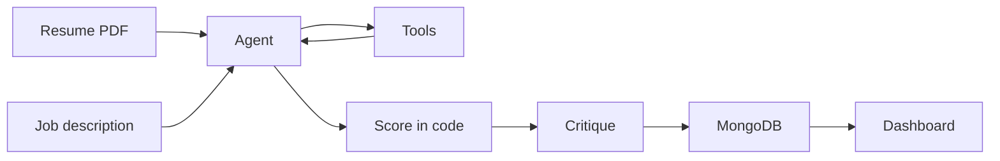

# Architecture

The home page posts a PDF and a job description to `POST /api/analyze`. The route checks the session, the rate limit, the PDF header, the size, and the page count, then streams progress as server-sent events.

`lib/agent/run.ts` is what actually runs:

1. Parse the resume. The model may call `extract_keywords`.
2. Extract job requirements. Same tool, on the job description.
3. Score in `lib/scoring.ts`. The model does not choose this number.
4. Critique the match. If it sets `ok` to false, that step runs once more.
5. Rewrite weak bullets. The model may call `rewrite_bullet`.

Each model reply is checked with Zod. Invalid JSON is sent back with the error, up to two retries, then the request fails. `gemini-2.5-flash` goes first. `gemini-2.0-flash` is the fallback.

Identical resume text and job description are cached in MongoDB for one hour (TTL index on `createdAt`). A signed-in user's new score is still compared with their previous saved score after the cache lookup.

Raw PDF bytes are not stored.

