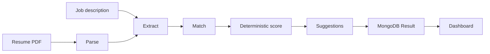

# Architecture

The home page posts a PDF and a job description to `POST /api/analyze`. The route checks the session, the rate limit, the PDF header, and the text length, then streams progress as server-sent events.

The pipeline in `lib/ai/pipeline.ts` is:

1. **Parsing** — clean extracted text with Gemini.
2. **Extracting** — separate calls for job requirements and a resume profile. Each response is validated with Zod.
3. **Matching** — `lib/scoring.ts` computes matched and missing skills. The score is a weighted sum in code: 50% must-have skills, 20% nice-to-have, 20% keywords, 10% experience alignment.
4. **Scoring** — Gemini writes the explanation. It does not choose the number.
5. **Suggesting** — rewrite suggestions, then a summary rewrite. Keywords that appear in that summary are applied and the score function runs again.

Results are stored on the `Result` document with the model name, per-step latency, and token counts. Raw PDF bytes are not stored.

